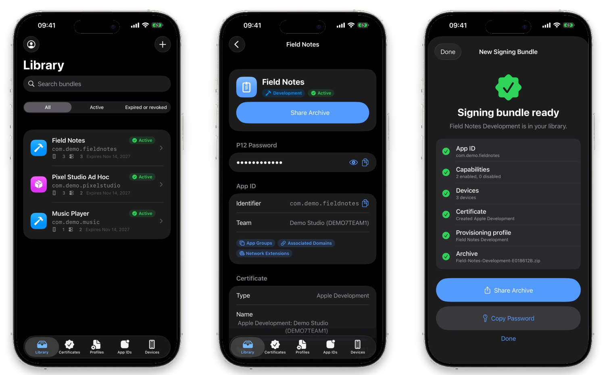

# SignUtils

[](https://github.com/itoolio/signutils/actions/workflows/ci.yml)
[](https://github.com/itoolio/signutils/actions/workflows/release.yml)
[](https://github.com/itoolio/signutils/actions/workflows/e2e.yml)

SwiftUI app for iPhone, iPad and Mac that turns App Store Connect API credentials into ready-to-import code signing assets.

<p align="center"></p>

## Download

<p>
  <a href="https://apps.apple.com/app/signutils/id0000000000"></a>
  &nbsp;
  <a href="https://github.com/itoolio/signutils"></a>
</p>

## Features

- Pick Development or Ad Hoc signing and the certificate type
- Register a new App ID, including wildcards, or reuse an existing one
- Turn capabilities on or off for the App ID
- Select registered devices or register new ones by UDID
- Create a new certificate or reuse one SignUtils made before, with the private key kept in the Keychain
- Get a zip with the `.p12`, its password, the `.mobileprovision`, the certificate and an `info.json` summary
- Keep every bundle in a library that tracks expiry, revoked certificates and deleted profiles
- Revoke certificates, delete profiles and App IDs, and register, rename, enable or disable devices
- Try everything in a demo that never touches a real account

## Requirements

An App Store Connect API key with the Admin or App Manager role, created under Users and Access → Integrations → App Store Connect API. SignUtils runs on iOS and iPadOS 18 and macOS 15 or later.

## Development

```bash
brew install xcodegen
xcodegen generate
open SignUtils.xcodeproj
```

The signing logic lives in the `SignKit` package: an App Store Connect client, CSR and PKCS#12 encoders, a zip writer and the generator that ties them together.

```bash
cd Packages/SignKit && swift test
```

The live suite creates a throwaway App ID, certificate and profile on your team, checks the `.p12` with OpenSSL and the Security framework, and revokes and deletes everything afterwards.

```bash
cd Packages/SignKit && SIGNUTILS_E2E=1 APP_STORE_CONNECT_KEY_ID=… APP_STORE_CONNECT_ISSUER_ID=… APP_STORE_CONNECT_PRIVATE_KEY_BASE64=… swift test --filter LiveTests
```

App Store screenshots are rendered from the demo by UI tests:

```bash
./scripts/screenshots.sh iphone ipad mac
```

## Contributors

[](https://github.com/itoolio/signutils/graphs/contributors)
